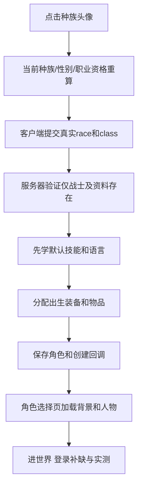

# 第一课：先把游戏拆成六个你能理解的零件

把建角色想成办一张入场证：客户端负责表格和预览，服务器决定是否批准，数据库存人，资源负责把人画出来。一个按钮亮了，只能说明表格看起来可填，不能说明审批、装备和语言都准备好了。

| 零件 | 本次实际例子 | 大白话作用 |
|---|---|---|
| 创建页脚本 | YB里的CharacterCreate.lua、RebornRacePreview.lua | 点哪个头像、有哪些职业、哪个亮哪个灰、名字怎么随机 |
| 选角场景脚本 | YB里的GlueParent.lua | 已有角色站在哪个背景舞台，不是人物本体 |
| 客户端DBC | ChrRaces、CharBaseInfo、XA的CharStartOutfit | 可选种族/职业组合、出生服装预览数据 |
| 服务端C++ | SharedDefines、RaceMgr、ObjectMgr、DBCStores、Player、CharacterHandler | 编号/容量、资格、技能授予、建角检查与执行顺序 |
| 服务端DBC+WORLD表 | 两套Data/dbc；playercreateinfo等 | 出生地、技能资格、装备行、默认动作条与食物 |
| 恢复模块 | mod-reborn-coa-birth | 创建/登录时检查缺少的基础技能和语言，不能代替完整建角逻辑 |

## 第一步：不要把三个“编号”混为一谈

真实raceID像身份证号码：39、49，保存进角色数据。Glue枚举索引像界面列表的第几个按钮：新加头像后位置会变。token像内部英文文件夹名字：REBORNKULTIRAN、Maghar。显示名像中文名片。它们不能互相替换。

例如创建页第6个按钮可能对应race39，不能把6写进数据库当39。两个“兽人”可能阵营不同，因此只按中文名字找种族会找错。先列真实ID、token、阵营、性别，再看界面位置。

## 第二步：先问“在哪一幕坏”

世界内模型正常，选角页却黑屏或蓝白方块：优先查舞台背景。创建页身体破损而头正常：应查M2/SKIN/贴图依赖和外观槽位，不能直接定为服务器race支持错误。按创建就客户端ACCESS_VIOLATION：还要读客户端崩溃地址/调用链，不能拿服务器worldserver战场崩溃代替这次问题。

本窗口不声称重新反汇编证明了每个旧客户端崩溃根因。Claude的DLL路线由Claude维护；Codex本次不改Wow.exe和三个DLL。

## 第三步：先收集证据，再改最小范围

记录完整路径、输入哈希、旧行为、复现顺序。哈希是文件指纹：同名文件被别人更新后，名字不变、指纹会变。对比当前指纹=包内旧文件可以覆盖，=新文件说明已装；两边都不等先合并。

不能只说“最新的YB”：后加载MPQ同路径会覆盖前面的表。也不能只说“源码覆盖了”：没有重新生成并编译/部署，运行的EXE仍可能是旧代码。编译成功、用户进游戏通过、Git已推送是三件事。
